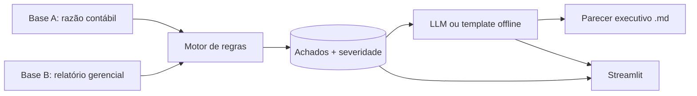

# AI Financial Doc Validator

Agente que concilia duas bases financeiras, aplica regras de negócio e entrega um **parecer executivo de auditoria**, trocando a conferência manual por uma validação reproduzível.

> **Dados 100% sintéticos.** Este repositório é uma reconstrução didática de um case real. Nenhuma informação, estrutura ou dado de empresa foi usado.

## O problema

Conferir e cruzar mais de 20 arquivos financeiros críticos (conciliações de bases e relatórios) era um trabalho manual, lento e sujeito a erro humano, que criava gargalo no fechamento.

## A solução

1. **Motor determinístico de regras** (`validator/reconcile.py`) cruza as bases e classifica cada divergência por regra e severidade.
2. **Camada de LLM** (`validator/report.py`) redige o parecer executivo a partir do resumo e dos maiores achados.
3. **Interface Streamlit** (`app.py`) permite ajustar tolerâncias, filtrar achados e baixar os resultados.

**Decisão de projeto:** o LLM nunca calcula nada. Todos os números vêm do motor de regras e o modelo só os explica, com instrução explícita para não inventar valores e tratar causas como hipóteses. Isso mantém o resultado auditável e reduz o risco de alucinação. Sem chave de API, o parecer sai por template determinístico (modo `offline`), então o projeto roda por completo sem custo.



## Regras implementadas

| Regra | O que detecta |
|---|---|
| R01 / R02 | Documento presente em uma base e ausente na outra |
| R03 | Divergência de valor acima da tolerância |
| R04 | Possível transposição de dígitos (ex.: 12.980,50 vs 12.908,50) |
| R05 | Documento duplicado |
| R06 | Datas que diferem além da tolerância (padrão: 3 dias) |
| R07 | Centro de custo diferente entre as bases |

Severidade pela exposição financeira: **Alta** ≥ R$ 10.000, **Média** ≥ R$ 1.000, **Baixa** abaixo disso (R06 e R07 são sempre Baixa).

## Resultado na base sintética (seed 42)

| Métrica | Valor |
|---|---|
| Documentos únicos | 300 |
| Anomalias injetadas / detectadas | 54 / 54 |
| Precisão e recall | 100% / 100% |
| Exposição total identificada | R$ 721.533,90 |
| Conformidade das bases | 82,0% |

O gerador injeta anomalias com gabarito (`ground_truth.json`) e o teste automatizado confere o motor contra ele. Esses números **validam a lógica das regras, não o desempenho em dados reais**, que trazem ruído que o gerador não reproduz.

## Como rodar

```bash
git clone https://github.com/thiagodouradof/ai-financial-doc-validator
cd ai-financial-doc-validator
python -m venv .venv && source .venv/bin/activate   # Windows: .venv\Scripts\activate
pip install -r requirements.txt

python -m validator.generate_data        # gera data/*.csv e ground_truth.json
python run_validation.py                 # CLI: gera outputs/findings.csv e outputs/parecer.md
streamlit run app.py                     # interface web
python -m pytest                         # testes
```

### Usando um LLM de verdade (opcional)

```bash
pip install anthropic            # ou openai / google-generativeai
cp .env.example .env             # preencha a chave e exporte as variáveis no terminal
export ANTHROPIC_API_KEY=...
python run_validation.py --provider anthropic
```

O modelo padrão de cada provedor pode ser trocado com a variável `LLM_MODEL`. Se a chamada falhar, o sistema cai no modo offline e avisa no próprio parecer.

## Usando com seus próprios CSVs

Cada base precisa das colunas `doc_id`, `data`, `centro_custo` e `valor`. Na interface, escolha **Upload de CSV**.

## Estrutura

```
├── app.py                  # interface Streamlit
├── run_validation.py       # CLI
├── validator/
│   ├── generate_data.py    # dados sintéticos + gabarito
│   ├── reconcile.py        # regras, severidade, métricas
│   └── report.py           # prompt, provedores de LLM e modo offline
├── tests/test_reconcile.py
└── data/                   # CSVs e JSON sintéticos (gerados)
```

## Próximos passos

- Mapeamento configurável de colunas e regras via YAML
- Conciliação com tolerância por valor relativo e por conta
- Saída estruturada (JSON) do LLM, validada por schema
- Deploy do app no Streamlit Community Cloud

## Autor

**Thiago Dourado Fontenla** · [LinkedIn](https://www.linkedin.com/in/thiago-dourado-fontenla/) · [GitHub](https://github.com/thiagodouradof)

Licença MIT.
